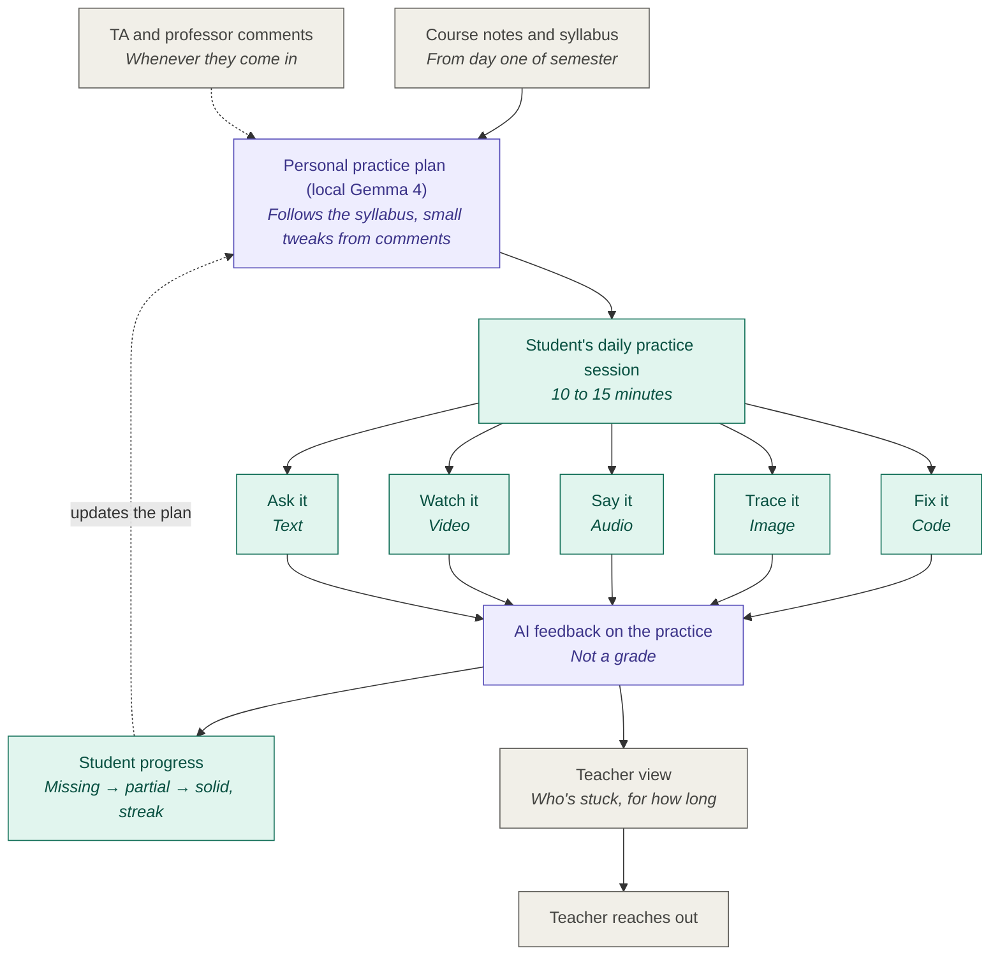

# Pineapple-
A team project for excellence

Our entry for the **IEEE AI Hackathon 2026 – Multimodal LLM Challenge**

## The problem
A professor often teaches a lecture of 100 or more students. They do not have time to check if each student really understands the material, or to give each student practice on their own weak topics. Students get a lecture, some homework and an exam, and many only find their gaps when the exam grade comes back. By then it is too late to fix them.

## What we are building
**Pineapple** turns a professor's course notes and syllabus into short daily practice sessions for each student. It is built mainly for **college and university courses**, but it works for any course with notes and a syllabus.

- From **day one of the semester**, the professor uploads the course notes and syllabus.
- **Whenever they come in**, TA and professor comments on a student's work are added too.
- A local AI model builds each student a **personal practice plan** that follows the syllabus. Comments help it spot the student's weak points, and it adjusts the plan a little to cover them.
- The student does a **10 to 15 minute practice session** each day and gets **AI feedback, not a grade**.
- The professor sees **who is stuck, and for how long**, and reaches out to them.

Pineapple runs fully on the university's own machine, with open-weight AI models. No student data goes to the cloud.

It works **alongside the university's LMS** (Canvas, Moodle, Blackboard or Google Classroom). It does not replace the LMS. The LMS keeps assignments and official grades. Pineapple never grades. It gives practice and shows what each student actually understands.

## How it works

*Dashed = comes in at any time · Purple = local AI · Teal = student · Gray = teacher and data*

### 1. Inputs
- **Course notes and syllabus**, uploaded from day one of the semester. The notes are the knowledge base for every exercise and every answer. The syllabus tells the plan which topics come when.
- **TA and professor comments**, added whenever they come in. For example, a TA's comment on a homework submission: "Treats `LEFT JOIN` like `INNER JOIN` in Q2." These are optional. The plan never waits for them, and works without them.

### 2. Personal practice plan
The local model (Gemma 4) builds a plan for each student. **The syllabus drives the plan**: each day's session covers the current week's topics, so every student keeps pace with the course.

Comments do not change the course of the plan. The AI reads each comment to judge the student's weak points, then adjusts the plan a little: it adds a few exercises on those weak points to the daily session, next to the syllabus topics. Results from the daily sessions also feed back into the plan, so the extra exercises stop once a weak topic becomes *solid*.

### 3. Daily practice session (10 to 15 minutes)
Each exercise uses one of the five input types:

| Exercise | Input | What the student does |
|---|---|---|
| **Fix it** | Code | Finds and fixes the bug in a short program or query, for example a SQL query that returns the wrong rows |
| **Trace it** | Image | Traces a process step by step on paper (a B+ tree insert, a join, a normalization), takes a photo, and gets step-by-step feedback |
| **Say it** | Audio | Explains *why* out loud. The answer is marked *solid*, *partial* or *missing*. Background voices are flagged |
| **Watch it** | Video | Watches a short clip from the course and answers a question about it |
| **Ask it** | Text | Asks doubts in a chat that answers only from the professor's notes, and says so when something is not covered |

### 4. AI feedback, not a grade
After each exercise, the AI explains what was right and what was wrong. This is feedback for practice. It never becomes an official grade, and nothing goes to the LMS gradebook.

### 5. Student progress
Each topic moves from *missing* to *partial* to *solid*. Streaks and XP keep the student coming back. When a topic becomes *solid*, the student's pineapple grows a leaf. Progress updates the practice plan for the next day.

### 6. Teacher view and outreach
The professor (or TA) sees **who is stuck, on which topic, and for how long**. For example: "Jordan has been *partial* on outer joins for 9 days." The professor decides whether to reach out, by email, in office hours, or in a recitation.

## First test course: DBMS
We are testing Pineapple with our own **Database Management Systems (DBMS)** course notes. DBMS is a good fit because it uses all five input types naturally:
- **Code:** buggy SQL queries to fix, run on a small sample database (SQLite)
- **Image:** tracing B+ tree inserts, joins, relational algebra and normalization on paper
- **Audio:** explaining *why* a query or a design is correct
- **Video:** short clips from the course lectures
- **Text:** doubts answered from the lecture notes

## Demo story: Maya, DBMS course
**Day one.** The professor uploads the DBMS notes and syllabus. Maya's plan follows the syllabus: ER models, then relational algebra, then SQL.

**Week 5, a comment comes in.** The TA grades Maya's joins homework in the LMS and leaves a comment: "Treats `LEFT JOIN` like `INNER JOIN` in Q2." The AI reads it and marks *outer joins* as a weak point for Maya. Her plan stays on the syllabus, which has moved on to `GROUP BY` and aggregation this week, but it adds a few outer join exercises to her sessions.

**The next day, her 12-minute session.** Most of it is this week's syllabus topic, with the weak point mixed in:
1. **Fix it** (this week): a query that should count students per course has a `GROUP BY` bug. She fixes it, runs it, and checks the counts.
2. **Trace it** (weak point): she traces on paper which rows a `LEFT JOIN` keeps from two small tables, and takes a photo. The feedback shows she now keeps the unmatched rows with `NULL`s.
3. **Say it** (weak point): "Explain the difference between a `LEFT JOIN` and an `INNER JOIN`." Clear answer → *solid*.
4. **Watch it** (this week): a 1-minute clip from the aggregation lecture, then one question about `HAVING` versus `WHERE`.
5. **Ask it:** "Does MySQL support `FULL OUTER JOIN`?" → "This isn't covered in your course notes. Ask in class or office hours." This shows the app refusing to answer outside the professor's materials.

Her streak goes up, *outer joins* moves from *partial* to *solid*, and the pineapple grows a leaf. With the weak point now *solid*, her next sessions go back to syllabus topics only.

**Teacher view.** The professor sees that Maya is no longer stuck, but Jordan has been *partial* on outer joins for 9 days. The professor emails Jordan to come to office hours.

This covers all five input types in about two minutes.

## Screens
1. **Student daily session (phone):** home with streak, XP, today's topics and topic statuses → the five exercises → a done screen showing topic changes and XP earned.
2. **Teacher view:** who is stuck, on which topic, and for how long. It also shows topic statuses across the class, so the professor knows what to reteach.

We have earlier clickable mockups as a design target. They still use a physics example and the older exercise names, and need to be updated to this flow.

## Privacy and safeguards
- **No grading.** The AI gives practice feedback only. Official grades stay with the professor and the LMS.
- **The teacher decides.** Pineapple shows who is stuck. A person decides whether and how to reach out.
- **"Stuck", not "at risk".** The teacher view describes topics and time, never labels like "failing" or "cheating".
- **Students can see what's shared.** A student sees the same topic statuses that the professor sees.
- **Everything runs on the university's own machine.** No third-party cloud processor touches student data, which helps with FERPA.

## Design
- Our own look: dark leaf green and pineapple yellow on a warm off-white, with Space Grotesk headings, and a pineapple mascot. We use generic game mechanics (streaks, XP, short sessions) but not another app's look, mascot or names.
- Status colors differ in lightness as well as hue, so they stay readable for colorblind users.

## Scope and build order
1. **Inputs:** upload and index the DBMS notes and syllabus, and add comments.
2. **Five exercises:** get Fix it, Trace it, Say it, Watch it and Ask it working end to end, with AI feedback.
3. **Practice plan and progress:** build each day's session from the syllabus, with a few extra exercises on weak points found in comments and progress. This needs a small database for topic status and streaks.
4. **Student session screen:** wrap the exercises in the daily session screen, with streaks and XP.
5. **Teacher view:** who is stuck and for how long, if there's time.

## Later, if we have time
- **Pull comments from the LMS** automatically (Canvas or Moodle API) instead of adding them by hand
- **Advisor digest:** a weekly summary across a student's courses, with only topic-level trends
- **More subjects** beyond DBMS, such as algorithms, physics and calculus
- **Desktop app** version of the website

## Modalities
| Input | Where we use it |
|---|---|
| Text | Course notes, syllabus and comments as the knowledge base; the *Ask it* doubts chat |
| Code | *Fix it* buggy programs and queries on the student's weak topics |
| Image | *Trace it* photos of handwritten traces |
| Audio | *Say it* spoken explanations |
| Video | *Watch it* clips from the course |

## Technology
- **AI model:** Gemma 4 12B, one open-weight model that takes text, image, audio and video
- **Run locally with:** Ollama or llama.cpp
- **Backend:** Python, with LangGraph for the AI steps and RAG over the professor's notes
- **Code exercises:** SQLite for running student SQL safely on a sample database
- **Interface:** a website for now (it may become a desktop app). It should also work on a phone.
